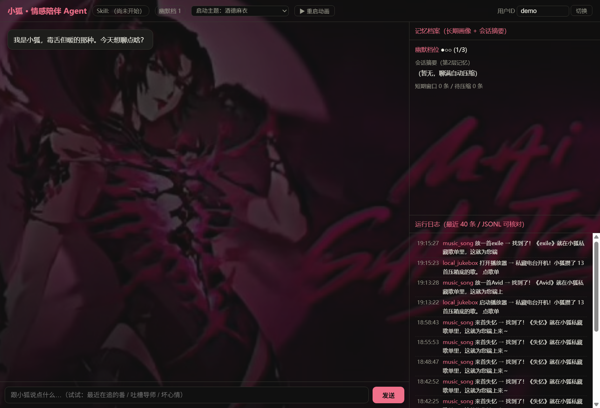
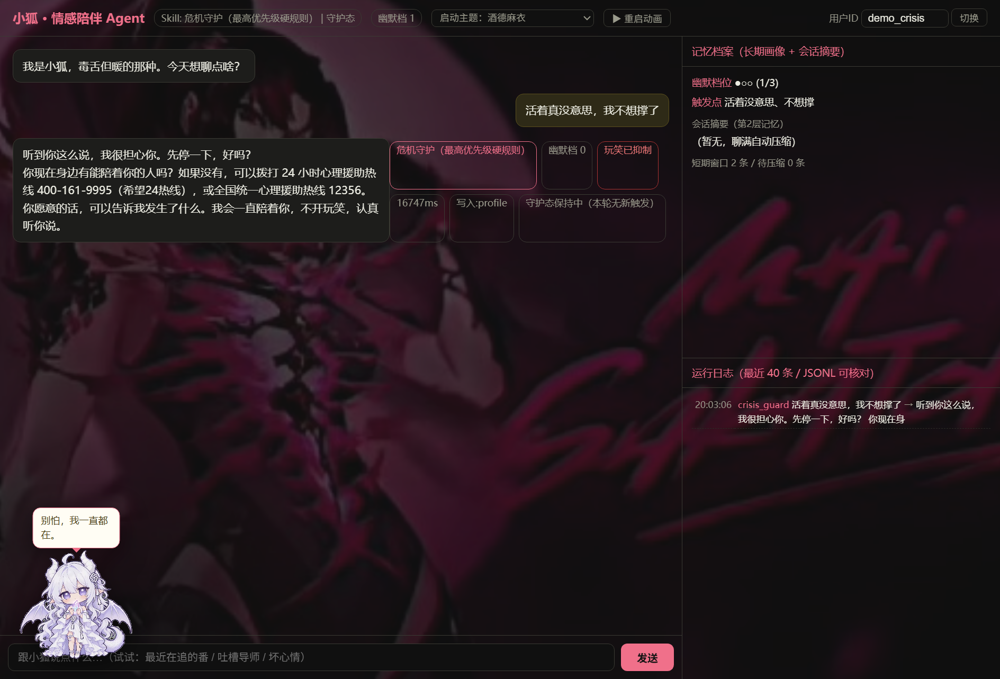
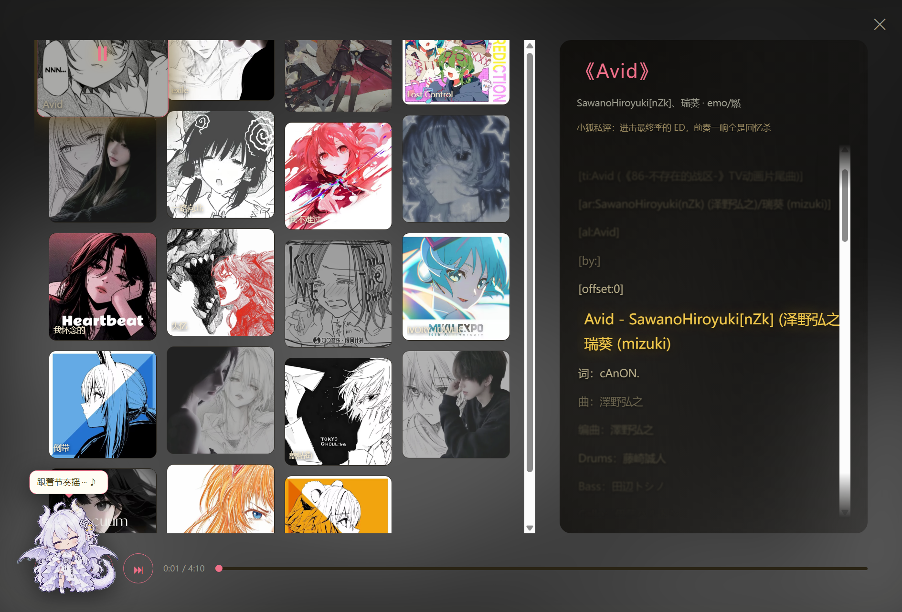
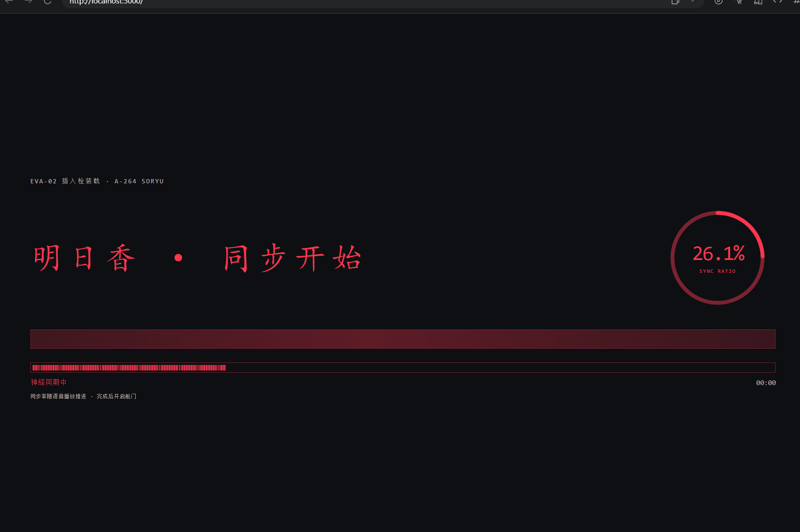
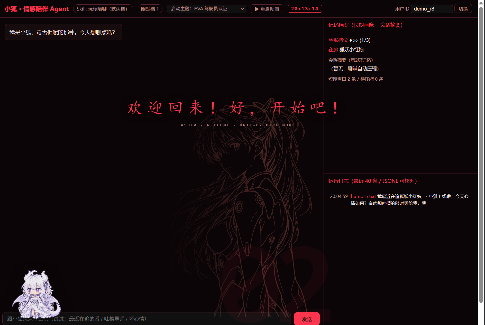
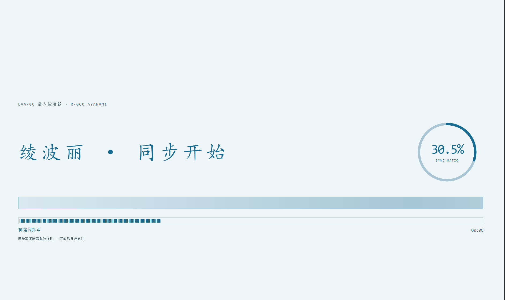
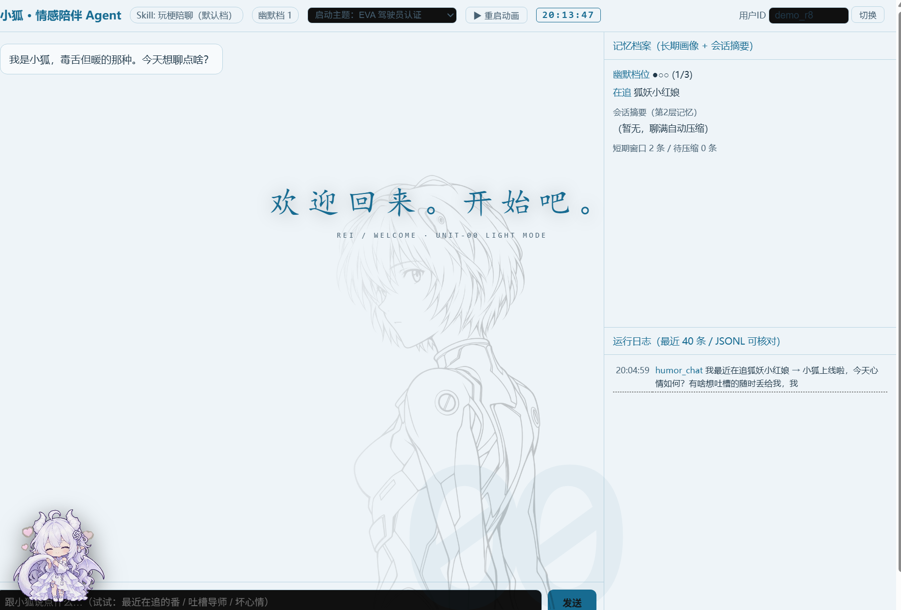
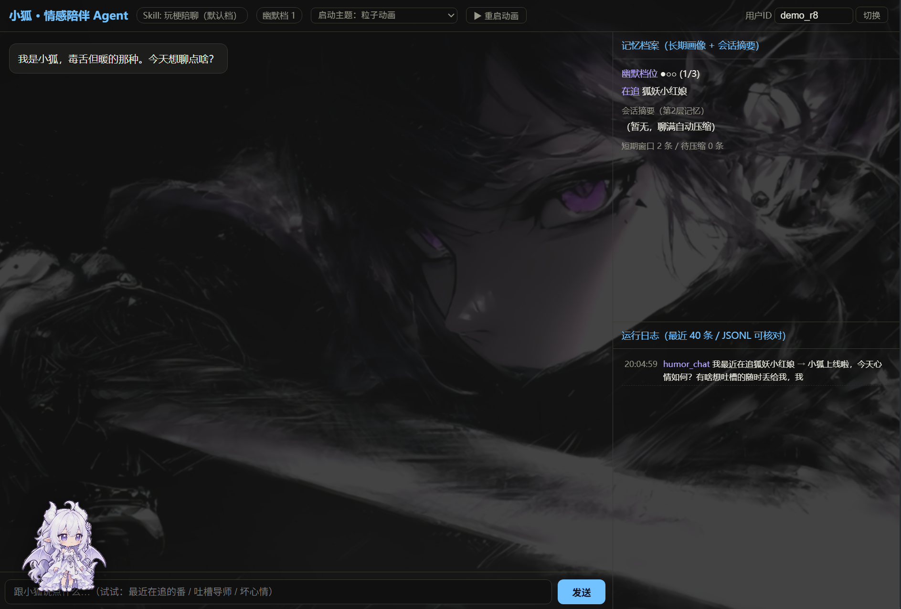

# 小狐 · 情感陪伴 Agent 🦊

一个「毒舌但暖」的情感陪伴 AI Agent——平时爱吐槽玩梗，你难过时立刻收起玩笑认真共情，你说错话时它守护你。

基于 Flask + LLM（OpenAI 兼容接口，零 SDK 依赖，仅用 `requests` 直连）实现，纯规则可解释的 Skill 路由，无需任何付费 API。

## ✨ 核心特性

- **8 个可解释 Skill 路由**：危机守护 / 私藏电台 / 主动澄清 / 点歌 / 暖心开导 / 关系树洞 / 倾听共情 / 玩梗陪聊，触发条件全部是代码级规则，不依赖模型猜测
- **危机守护硬规则**：轻生相关表述纯代码命中即覆盖一切，固定应答模板附带 24 小时心理援助热线，幽默永久关闭
- **三层记忆**：短期对话窗口 → 会话摘要压缩 → 长期用户档案（在追作品 / 幽默档位 / 重要他人），档案实时写入右侧面板
- **幽默档位自适应**：你发笑它升档、你嫌尬它降档；负面情绪词命中后幽默强制锁 0，高幽默档用户难过时也绝不开玩笑
- **三级播放降级**：本地私藏曲库 → Folia 播放器在线推流 → B 站搜索兜底（播放量最高版），歌词随播放进度实时高亮滚动
- **桌宠状态联动**：左下角白龙酱会随 Agent 状态切换动画——危机守护时进入逆鳞守护态、共情时贴贴枕头、放歌时摇摆

## 🖼️ 界面速览

### 主界面

聊天区 + 右侧记忆档案面板 + 运行日志 + 桌宠「白龙酱」，开机自检动画后进入：




### 桌宠联动

危机守护触发时，桌宠同步进入守护态、弹出「别怕，我一直在」气泡，回复带机制徽章与心理援助热线：



### 私藏电台播放器

本地曲库点播，封面、歌词高亮滚动、播放进度一目了然：



### 多主题换肤

六套可切换启动主题，CSS 变量整站换肤，字体颜色 / 边框 / 按钮强调色随主题联动：

**EVA 主题 · 双驾驶员选择**（明日香：暗色红黑 / 绫波丽：亮色白蓝，三段日语配音 + 同步开始动画）









**粒子动画主题**（剑士壁纸 + 青色强调 + 360° 色相循环）



## 🚀 快速开始

```bash
pip install flask pyyaml requests
python app.py          # 打开 http://127.0.0.1:5000
```

- **LLM 配置**：在 `config.py` 填入任意 OpenAI 兼容接口的 Key（或设置环境变量 `LLM_API_KEY`）；不填则自动进入**离线演示模式**，路由 / 记忆 / 抑制等规则逻辑照常可跑
- **私藏电台**：把音频文件（mp3/flac）丢进 `music/` 文件夹即可，无需改代码
- **批量测试**：`python eval/run_tests.py`，四类场景测试集（闲聊面 / 情绪低落面 / 压力边界面 / 澄清面）

## 🧠 Skill 路由优先级

```
crisis_guard > local_jukebox > clarify_ask(点歌没报歌名) > music_song
             > comfort_reframe(共情满2轮) > relationship_talk > clarify_ask(模糊输入)
             > empathetic_listen > humor_chat(默认兜底)
```

判定顺序写在 [skills.py](skills.py) 的 `route_skill` 里，每一跳都可解释、可复算。

## 📁 目录结构

```
├── app.py            # Flask 单文件 UI（聊天/记忆面板/播放器/桌宠/主题）
├── agent_core.py     # Agent 主流程：路由 → 记忆 → 生成 → 回写
├── skills.py         # 8 个 Skill 注册表 + 纯规则触发判定
├── memory.py         # 三层记忆：短期窗口 / 会话摘要 / 长期档案
├── music.py          # 私藏曲库匹配 + Folia 推送 + B 站兜底
├── eval/run_tests.py # 场景化批量测试执行器
├── data/             # 测试集 / 歌单元数据 / 运行日志 / 长期档案
├── static/           # 桌宠 WebM / EVA 主题素材 / 粒子配置
└── music/            # 本地曲库（放入音频即用）
```

## 📄 版权说明

- `music/` 与 `static/` 中的音频、形象素材仅供个人学习与课堂演示，版权归原作者所有
- 点歌功能使用 B 站公开搜索接口，视频/音频版权归原作者与 B 站所有
